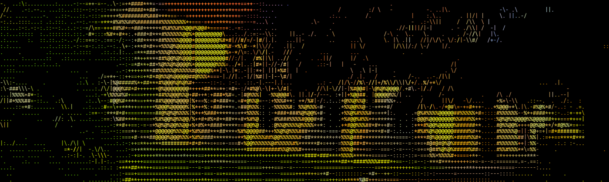
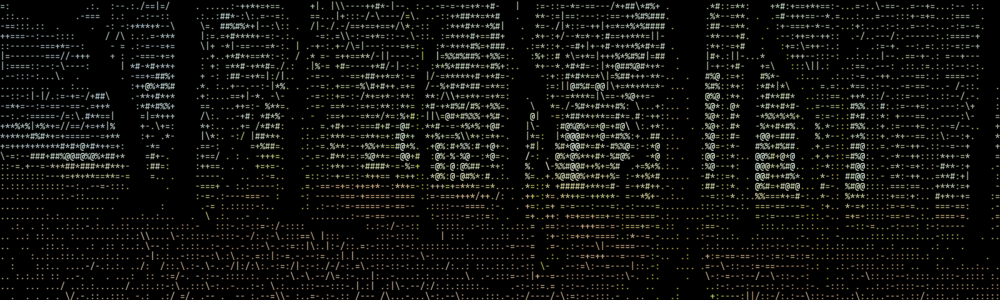
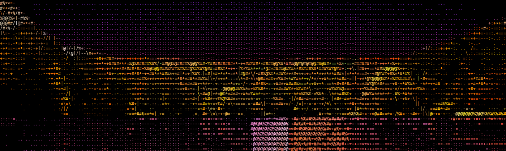
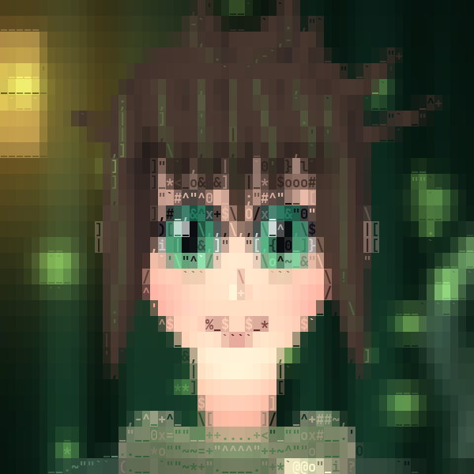
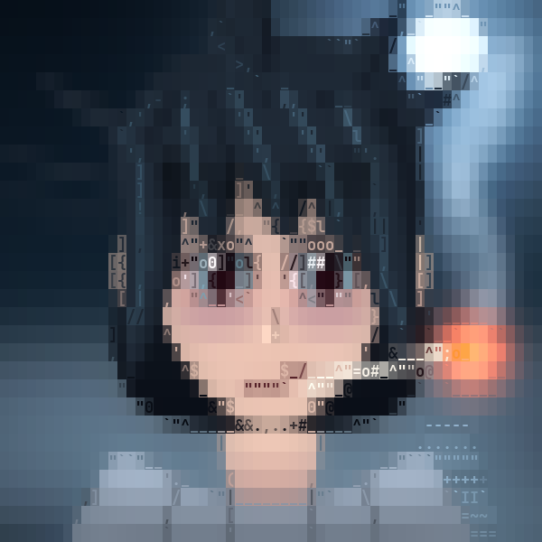
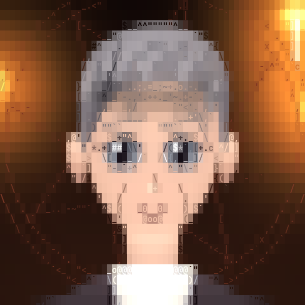
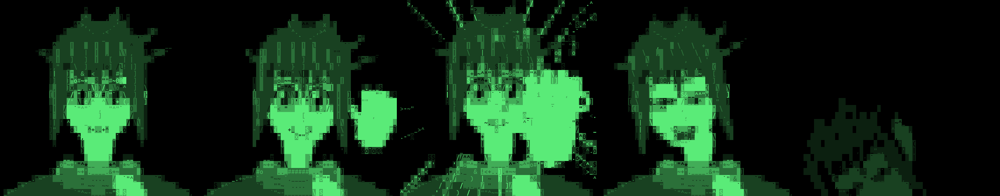
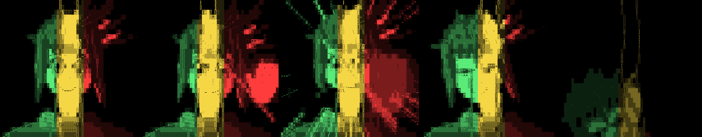

<h1 align="center">F O L K</h1>
<p align="center"><em>a folk-horror story you play in your terminal</em></p>

<p align="center"></p>

You inherit a house in a small town you have never heard of. You are not the only one who has been waiting for you:
a boy who is too eager to be your friend, a man who is too kind, and someone sitting on a bench by the lake who seems to
know you already. **FOLK** is a text adventure told in seven chapters with decisions, a boss fight, three endings and a
hidden fourth. Everything is drawn with letters: coloured ASCII pictures, animated scenes, a lyric scene, a screen that
glitches. It runs in any modern terminal. It needs **no** third-party packages, only Python.

> ### Content warning
> This is a horror game with **graphic, visceral violence and gore**. It deals with **child abuse, suicide, self-harm,
> cults, burning, and body horror**. It is written for adults. If any of that is a problem for you, please skip it.

## Play it

```bash
git clone https://github.com/ilvy23/noah-game.git
cd noah-game
python3 play.py
```

* **Python 3** (developed and tested with 3.14; only the standard library is used). It is developed on Linux; macOS terminals should work, Windows is untested (try WSL).
* **A big terminal** looks best: **140×35 or larger** for the wide pictures (245×44 is what the author plays in). Smaller windows
  get smaller pictures, and below 52×24 there are none. Use a terminal with colours; truecolor (`echo $COLORTERM` prints
  `truecolor`) looks best.
* **Controls:** `↑` `↓` and `Enter` to choose (or type the number), `Enter` / `Space` skips the text that is being typed.
  `Ctrl+C` leaves.
* **Sound is optional** (see below). For music and effects install [`mpv`](https://mpv.io/) (or `ffplay`).
* Your progress is saved to `save_story.json` next to the game.

## Music is not included

The author plays it with a playlist of commercial songs which cannot be shared. **The game runs without any music**, and
every song has a file name and a place described in [`soundtracks/README.md`](soundtracks/README.md): drop your own tracks in
to bring the atmosphere back. The 226 sound effects that are included are CC0
([sources](docs/SFX-DOWNLOADED.md)); 42 more that the author used cannot be shared, so those moments are silent
until you add your own files.

## Pictures

All pictures are made of letters and colour. The three places are made from the author's own photographs.

| | | |
|---|---|---|
|  |  |  |
| the forest | the lake | the castle |

| | | |
|---|---|---|
|  |  |  |
| Noah | Mika | Connor |

The boss fight has four phases and its own animations. Its first phase, and the last form (a spoiler: skip it if you want to
be surprised):



<details><summary>the last form (spoiler)</summary>



</details>

## Useful commands

```bash
python3 play.py --cinema        # every scene one after the other (spoilers!)
python3 play.py --gallery       # the portraits and fight animations
python3 play.py --fight         # straight into the boss fight (--nointro skips the long intro, --phase 1-4)
python3 play.py --list          # all scenes, shortcuts like --noah --mika --connor --dream --castle ...
python3 play.py --scene ID      # jump to one scene from the list
python3 play.py --artdemo       # how your terminal shows the pictures: send this if the colours look wrong
FOLK_WINSHAKE=0 python3 play.py # switch off the window shaking (it only works in xterm-like terminals)
```

The jump commands skip the story and **spoil it**. Read the content warning, then start with plain `python3 play.py`.

## Tests

```bash
python3 -m pip install pytest pillow numpy   # pillow and numpy are only used by tests and the picture tools
python3 -m pytest -q tests
```

The whole game is driven by a scripted input/output object, so the tests play full runs without a terminal.

## What is in the folder

| Path | What |
|---|---|
| `play.py`, `story_game.py` | entry point and the flow (places, chapters, decisions, endings, credits) |
| `story/story.json`, `text/` | the story: every scene, decision tree and line |
| `ui.py`, `ascii_art.py`, `*_fx.py` | text reveal, pictures, animated scenes and effects |
| `boss.py`, `boss_ui.py`, `patterns.py` | the boss fight |
| `audio.py`, `soundtracks/` | the sound system (mpv), tracks table and effects |
| `art/`, `tools/` | the pictures and the tools that made them |

`main.py` is the older prototype and is kept for its tests.

## Licence and credits

* Code: **MIT** ([`LICENSE`](LICENSE)).
* Story texts and pictures: **CC BY-NC 4.0** ([`LICENSE-CONTENT.md`](LICENSE-CONTENT.md)); credit **ilvy23**, no commercial use.
* Sound effects in `soundtracks/sfx/`: CC0, thanks to everyone on [freesound.org](https://freesound.org) who is listed in
  [`docs/SFX-DOWNLOADED.md`](docs/SFX-DOWNLOADED.md).
* Written by **ilvy23**. Drafted and built with Claude (Anthropic) and a local Qwen model.

Pull requests and bug reports are welcome. It is a hobby project made for a very specific mood: please play it in the dark.
